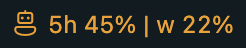
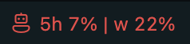

# bm.Codex Usage Monitor

Projects page: [WESTBOHEMIA.COM](https://www.westbohemia.com/developer/en/index.html).

A small Visual Studio Code extension that shows the remaining Codex usage in the status bar and its tooltip.

## What's new in 1.0.0

Version 1.0.0 adds configurable status bar display and color alerts:

- Choose to show the five-hour window, the weekly window, or both.
- Set separate warning and critical thresholds for each window. The defaults are 25% for warning and 10% for critical.
- The status bar turns orange below a window's warning threshold and red below its critical threshold. When both windows are displayed, the most severe alert determines the color of the combined item.

Configure these options in **Settings → Extensions → Codex Usage Monitor**:

| Setting | Default | Description |
| --- | --- | --- |
| `codexUsageMonitor.statusBar.displayWindows` | `both` | Select `both`, `fiveHour`, or `weekly`. |
| `codexUsageMonitor.statusBar.fiveHourWarningThreshold` | `25` | Orange alert threshold for the five-hour window, in percent. |
| `codexUsageMonitor.statusBar.fiveHourCriticalThreshold` | `10` | Red alert threshold for the five-hour window, in percent. |
| `codexUsageMonitor.statusBar.weeklyWarningThreshold` | `25` | Orange alert threshold for the weekly window, in percent. |
| `codexUsageMonitor.statusBar.weeklyCriticalThreshold` | `10` | Red alert threshold for the weekly window, in percent. |

Thresholds accept values from 0 to 100. For each window, the critical threshold must be lower than the warning threshold; otherwise, that window uses the default thresholds.

## Status bar color examples

The status bar item turns orange when a displayed usage window falls below its warning threshold. It turns red when a displayed window falls below its critical threshold. When both windows are shown, the more severe state determines the color.

- **Warning:** 5-hour usage at 45%, weekly usage at 22%.

  

- **Critical:** 5-hour usage at 7%, weekly usage at 22%.

  

## Requirements

- Visual Studio Code 1.90 or later
- The official OpenAI Codex VS Code extension

## How it works

The extension locates the Codex executable bundled with the OpenAI extension and starts its app server over standard input and output. It requests the account rate limits and displays the five-hour and weekly windows. The extension source does not make direct HTTP requests.

The extension does not read Codex session transcripts. The account rate-limit request is handled by the Codex app server.

## License

The project is free and open source under the MIT License.
